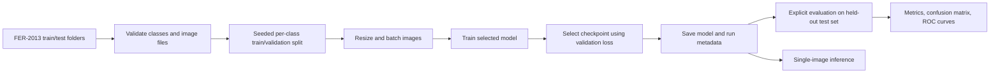

# Facial Emotion Classification

This repository contains a reproducible image-classification pipeline for recognizing seven facial-expression categories in the FER-2013 dataset. It provides two custom convolutional neural network (CNN) experiments and a ResNet50V2 transfer-learning experiment. The project classifies images; it does not detect faces in full-scene photographs.

## Project status and results

The repository initially described training and validation accuracies of 65%/57% for an augmented CNN and 71%/68% for ResNet50V2. Those figures are historical claims from the original project description: no training logs, saved checkpoints, or result artifacts were included, so they have not been independently verified or reproduced here. The original notebook export also evaluated the test split during ResNet training, which compromises its independence as a final test set.

This refactor separates validation from test evaluation and fixes the input ordering and score calculation used for evaluation. No new accuracy or benchmark is claimed. The dataset is not bundled; results require training with the dataset and recording the resulting metrics.

## Features

- Validates the expected FER-2013 train/test folder layout without deleting files.
- Creates a seeded, stratified validation split from training images.
- Trains a scratch CNN, an augmented scratch CNN, or an ImageNet-initialized ResNet50V2.
- Uses validation loss for checkpointing and early stopping; reserves the test split for explicit final evaluation.
- Reports accuracy, macro precision/recall/F1, a confusion matrix, and probability-based one-vs-rest ROC/AUC.
- Supports single-image inference from a saved model.

## Method

Images are loaded from class-specific directories, resized to 48×48 grayscale for the custom CNNs or 224×224 RGB for ResNet50V2, then batched. Files are not moved or changed. One fifth of each training class is deterministically set aside for validation; all test images remain outside training and model selection.

The custom CNNs follow the original convolutional design: convolution/ReLU blocks with batch normalization, max pooling, dropout, L2 regularization on later convolution layers, and a dense classification head. The augmented variant applies random horizontal flips, rotations, translations, and zooms only while training. The transfer-learning variant uses the ImageNet ResNet50V2 backbone, its `[-1, 1]` input scaling, a global-average-pooling head, and the Adamax optimizer. ResNet class weights are calculated from the training portion only.

For each image, the model produces class probabilities \(p_k\). The predicted class is \(\arg\max_k p_k\). ROC curves use these probabilities (one-vs-rest), not hard class predictions. Preprocessing and the augmentation ranges are made explicit in the code; the historical shear augmentation is not included in this refactor.

## Project layout

```text
.
├── pyproject.toml
├── README.md
├── src/
│   └── fer2013_emotion/
│       ├── config.py       # Experiment settings and variants
│       ├── data.py         # Dataset validation, splitting, TensorFlow input pipeline
│       ├── models.py       # CNN and ResNet50V2 construction
│       ├── training.py     # Training, callbacks, and run metadata
│       ├── evaluation.py   # Test metrics and visualizations
│       ├── inference.py    # Saved-model loading and image prediction
│       └── cli.py          # Command-line interface
└── tests/
    ├── test_data.py
    └── test_evaluation.py
```

## Workflow



## Dataset

Download the FER-2013 image-folder dataset from [Kaggle](https://www.kaggle.com/datasets/msambare/fer2013) using Kaggle's terms and access process. Extract it under `data/` so it has this shape:

```text
data/
├── train/
│   ├── angry/
│   ├── disgust/
│   ├── fear/
│   ├── happy/
│   ├── neutral/
│   ├── sad/
│   └── surprise/
└── test/
    ├── angry/
    ├── disgust/
    ├── fear/
    ├── happy/
    ├── neutral/
    ├── sad/
    └── surprise/
```

The validator expects seven matching class directories in both splits, at least two training images per class, at least one test image per class, and readable JPEG/PNG images. It reports invalid files and leaves them untouched. The dataset must be prepared separately; credentials and dataset files are not stored in this repository.

## Installation

Python 3.10 or newer is required by the package. TensorFlow wheel support depends on the Python version and operating system; consult the [TensorFlow installation guide](https://www.tensorflow.org/install) for a compatible environment. On Windows, WSL2 may be needed for supported TensorFlow configurations.

```powershell
python -m venv .venv
.\.venv\Scripts\Activate.ps1
python -m pip install --upgrade pip
python -m pip install -e ".[ml]"
```

On macOS/Linux, activate the environment with `source .venv/bin/activate`. Core dataset validation and metric tests need only the base dependencies; training and visualization require the `ml` extra.

## Usage

Commands below assume the dataset is in `data/`. Run them from the repository root after installing the project.

### Train

Choose `custom-cnn`, `custom-cnn-augmented`, or `resnet50v2`:

```powershell
python -m fer2013_emotion train --variant custom-cnn --data data
python -m fer2013_emotion train --variant custom-cnn-augmented --data data --epochs 100
python -m fer2013_emotion train --variant resnet50v2 --data data --seed 42
```

The command saves the best validation-loss checkpoint, training history, and run metadata under `outputs/<variant>/` by default. Override the location with `--output`. Use `--batch-size`, `--validation-fraction`, and `--seed` to adjust the run. A ResNet50V2 run may download ImageNet weights on first use.

### Evaluate the held-out test split

Test evaluation is a separate step and does not participate in training or checkpoint selection:

```powershell
python -m fer2013_emotion evaluate --model outputs/custom-cnn/model.keras --data data
```

Metrics and plots are written to `outputs/custom-cnn/evaluation/` by default. Output includes `metrics.json`, `confusion_matrix.png`, and `roc_curves.png`. The class order is read from saved metadata and checked against the dataset.

### Predict one image

```powershell
python -m fer2013_emotion predict --model outputs/custom-cnn/model.keras --image path\to\face.png
```

Inference resizes the supplied image to the model input shape and prints the predicted class, confidence, and per-class probabilities. It assumes the image already contains a suitable face crop; face detection is outside the project's scope.

### Run tests

```powershell
python -m unittest discover -s tests -v
```

The tests use small temporary image fixtures and do not download FER-2013 or train a neural network.

## Experiments and metrics

| Variant | Input | Augmentation | Optimizer | Checkpoint selection |
|---|---:|---|---|---|
| `custom-cnn` | 48×48 grayscale | None | Adam | Lowest validation loss |
| `custom-cnn-augmented` | 48×48 grayscale | Flip, rotation, translation, zoom | Adam | Lowest validation loss |
| `resnet50v2` | 224×224 RGB | Flip, rotation, translation, zoom | Adamax | Lowest validation loss |

The evaluation command computes accuracy and macro-averaged precision, recall, and F1, plus the confusion matrix and macro one-vs-rest ROC AUC. There are no verified experiment outputs included in the repository. Test results should only be reported after running the documented training and evaluation steps on a recorded dataset/configuration.

## Limitations

- FER-2013 labels and images have known ambiguity and class imbalance; test metrics do not establish real-world generalization.
- This is expression classification for an already-cropped face, not face detection, identity recognition, or a reliable assessment of a person's internal emotional state.
- The original performance figures are unverified, and the dataset and trained weights are not included.
- Training the custom CNNs and fine-tuning ResNet50V2 can require substantial memory and compute.
- The refactored augmentation omits the original shear transform; any new results are not directly comparable without matching the full experiment setup.

Potential extensions include recording dataset provenance and exact dependency/runtime versions per run, comparing additional held-out datasets, and adding a separate face-cropping stage.

## Technologies

Python, TensorFlow/Keras, NumPy, Pillow, scikit-learn, and Matplotlib.

## References

- FER-2013 dataset distribution: [Kaggle FER-2013](https://www.kaggle.com/datasets/msambare/fer2013).
- He, K. et al. “Deep Residual Learning for Image Recognition.” *CVPR 2016*. [Paper](https://doi.org/10.1109/CVPR.2016.90).
- [TensorFlow/Keras documentation](https://www.tensorflow.org/guide/keras).
